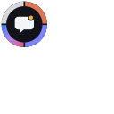
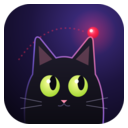
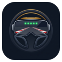

a few things i've "built"

| Project | What it is | Platform / Stack |
| --- | --- | --- |
| &nbsp; **[CalBar](https://github.com/TheHubOfGit/CalBar)** | a macOS menu bar app for checking your Google Calendar | macOS · Swift |
| &nbsp; **[Visual Git](https://github.com/TheHubOfGit/visual-git)** | a local web app for visualizing git history like a transit map | Node · React · TypeScript |
| &nbsp; **[Agent HUD](https://github.com/TheHubOfGit/agent-hud)** | a Pixel Watch HUD for keeping an eye on your AI coding agents from your desk | Wear OS · Node · Swift |
| &nbsp; **[Agent Threads](https://github.com/TheHubOfGit/agent-threads)** | a Wear OS app for continuing your AI coding agent chats from your wrist | Wear OS · Kotlin · Cloudflare |
| &nbsp; **[KettleTile](https://github.com/TheHubOfGit/KettleTile)** | a Wear OS app, tile, and watch face complication for controlling a COSORI kettle over Bluetooth | Wear OS · Kotlin · BLE |
| &nbsp; **[T3 Code Widget](https://github.com/TheHubOfGit/t3code-android-widget)** | an android home-screen widget for keeping an eye on your T3 Code threads | Android · Kotlin · Glance |
| &nbsp; **[Mass Times Finder](https://github.com/TheHubOfGit/mass-times-finder)** | a web app, CLI, and MCP server for finding nearby Catholic Mass times | Cloudflare · Python · PWA |
| <picture><source media="(prefers-color-scheme: dark)" srcset="assets/icons/allskills-dark.png"><source media="(prefers-color-scheme: light)" srcset="assets/icons/allskills-light.png"></picture>&nbsp; **[AllSkills](https://github.com/TheHubOfGit/AllSkills)** | a desktop app for syncing your AI coding skills across Claude, Codex, Cursor, and more | Electron · React · TypeScript |
| &nbsp; **[TheCatGame](https://github.com/TheHubOfGit/TheCatGame)** | a projector cat toy controlled live from your phone (laser, fish, and bird modes) | Android TV · Cloudflare |
| &nbsp; **[TypeRacer VR](https://github.com/TheHubOfGit/typeracer-vr)** | a chrome extension that lets you play TypeRacer from the driver's seat in VR | Chrome Extension · Three.js · WebXR |
