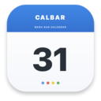
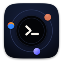

# Michael Brancazio

Selected public projects — desktop utilities, Wear OS tools, web apps, and experiments.

## Projects

| Project | What it is | Platform / Stack |
| --- | --- | --- |
| &nbsp; **[CalBar](https://github.com/TheHubOfGit/CalBar)** | Menu bar app for Google Calendar with next-meeting countdown, meetings-left status, and day swipe pager | macOS · Swift |
| &nbsp; **[Visual Git](https://github.com/TheHubOfGit/visual-git)** | Local web app that draws a repository's Git history as a rail map and explains Git in plain words (3 themes, diff viewer, CLI) | Node · React · TypeScript |
| &nbsp; **[Agent HUD](https://github.com/TheHubOfGit/agent-hud)** | Pixel Watch HUD & Mac bridge for monitoring and controlling AI coding agents from your wrist (with Live Mode + firmware mod) | Wear OS · Node · Swift |
| &nbsp; **[Mass Times Finder](https://github.com/TheHubOfGit/mass-times-finder)** | Catholic Mass schedule finder with sync pipeline, Worker API & MCP server, CLI, and web app | Cloudflare Workers · D1 · Python · PWA |
| <picture><source media="(prefers-color-scheme: dark)" srcset="assets/icons/allskills-dark.png"><source media="(prefers-color-scheme: light)" srcset="assets/icons/allskills-light.png"></picture>&nbsp; **[AllSkills](https://github.com/TheHubOfGit/AllSkills)** | Local desktop hub for managing and syncing a central AI coding skills library across AI apps | Electron · React · TypeScript |
| &nbsp; **[TheCatGame](https://github.com/TheHubOfGit/TheCatGame)** | Laser, fish & bird cat toy for projectors/TVs controlled live from a phone browser | Android TV · Cloudflare Pages & Durable Objects |
| &nbsp; **[TypeRacer VR](https://github.com/TheHubOfGit/typeracer-vr)** | Puts you in the driver's seat of your car on TypeRacer.com — in-page preview or Quest VR cockpit | Chrome Extension · Three.js · WebXR |
